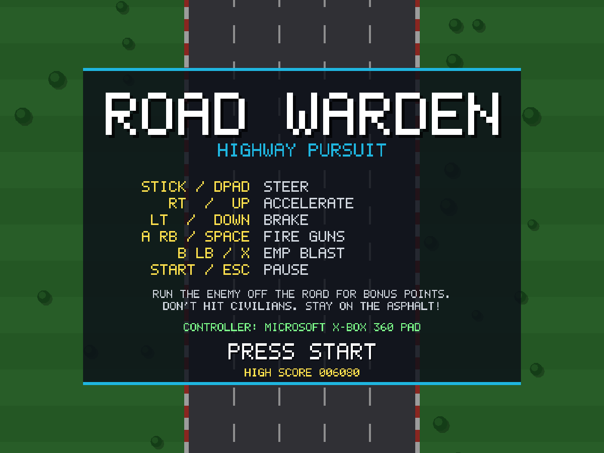
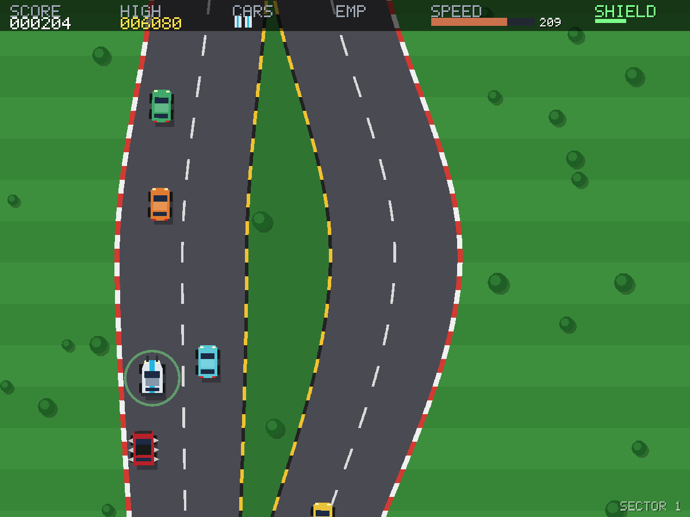
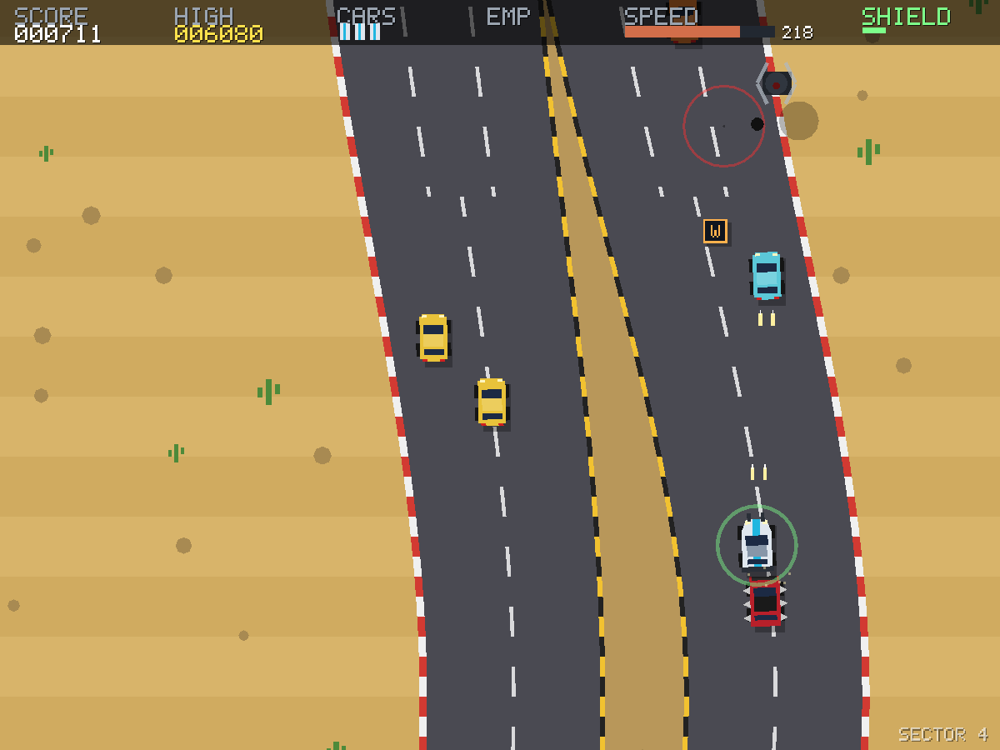
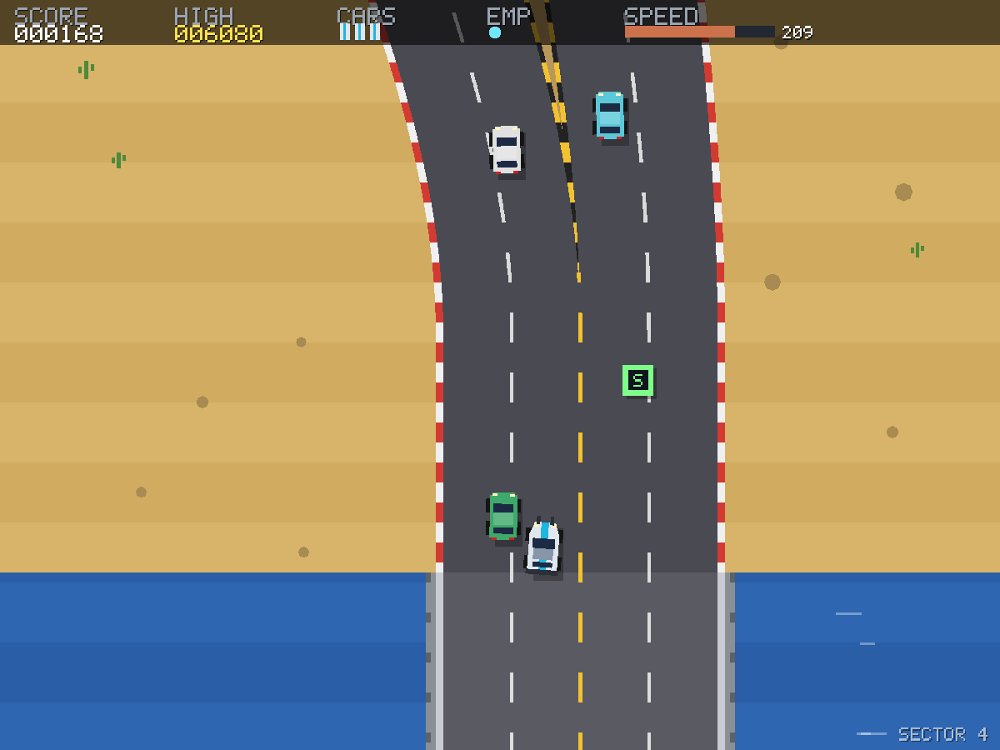

# Road Warden

Top-down highway pursuit shooter. C++17, X11 + legacy OpenGL, Linux joystick API
(USB gamepads, hot-plug, rumble), PulseAudio synth audio loaded at runtime.
No third-party libraries required.

| | |
|---|---|
|  |  |
|  |  |

## Build & run

    cmake -S . -B build && cmake --build build -j
    ./build/road_warden

F11 toggles fullscreen.

## Controls

| Action     | Gamepad (Xbox layout)  | Keyboard        |
|------------|------------------------|-----------------|
| Steer      | Left stick / D-pad     | Left/Right, A/D |
| Accelerate | RT (or stick up)       | Up, W           |
| Brake      | LT (or stick down)     | Down, S         |
| Fire       | A / RB                 | Space, Z        |
| EMP blast  | B / LB / Y             | X, Shift        |
| Pause      | Start                  | P, Esc          |
| Quit/back  | Back                   | Esc             |

PlayStation pads are detected by name and mapped to the same positions.

## Dev / test switches (env vars)

- `RW_NO_RUMBLE=1`: disable controller rumble
- `RW_AUTOPILOT=1`: the car drives itself (implies no rumble); logs death causes
- `RW_SECTOR=N`: start at sector N (harder enemies)

## License

MIT. See [LICENSE](LICENSE).
